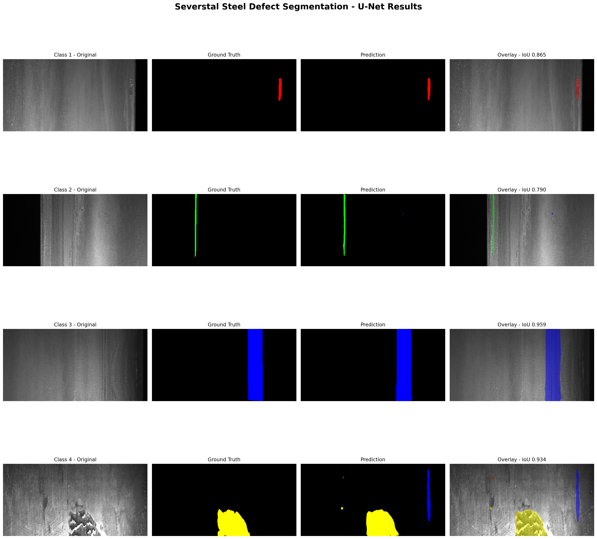
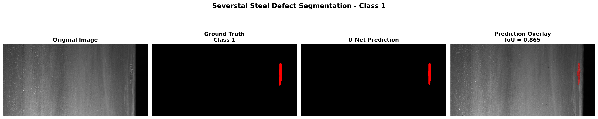
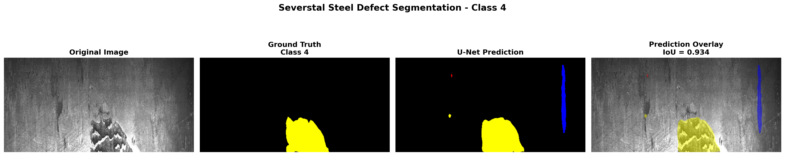
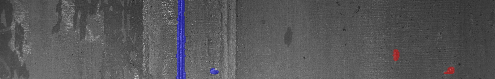
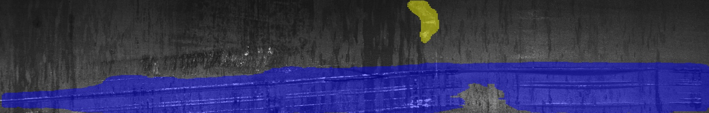
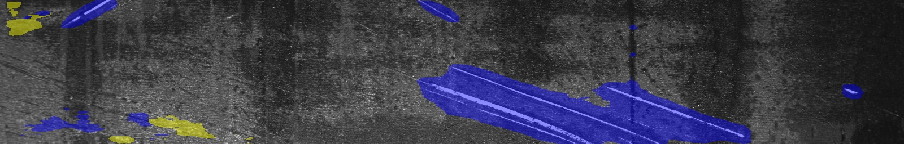
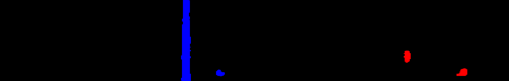
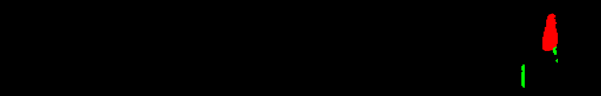
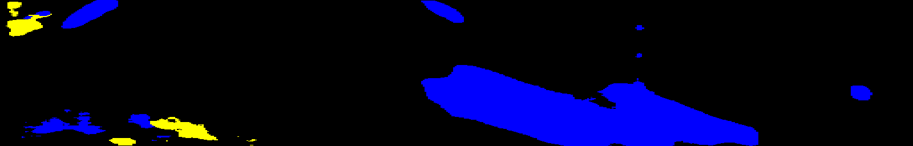
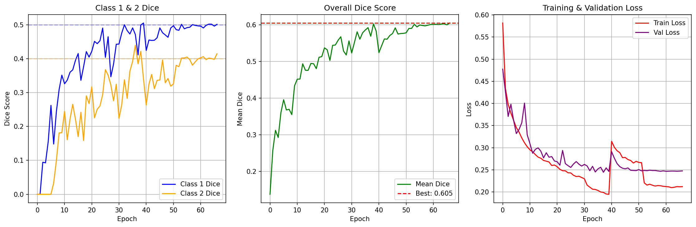

# 🏭 Severstal Steel Defect Segmentation

**Pixel-level steel surface defect segmentation using a custom U-Net architecture designed and implemented entirely from scratch.**

---

## 📌 Overview

This project implements an end-to-end **semantic segmentation pipeline for industrial steel surface defect detection** using the **Severstal Steel Defect Detection** dataset.

## Visual Demo

The examples below provide a quick visual comparison of the original steel image, the ground-truth mask, the U-Net
prediction, and the prediction overlay with IoU.







### Test Prediction Samples

#### Three Overlay Samples from `overlays1/`







#### Three Colored Mask Samples from `colored_masks/`







## Project Goal

The goal of this project was to build and evaluate a from-scratch U-Net model that can locate and classify defects on steel surfaces at the pixel level. This supports automated quality inspection by identifying the precise area and type of each defect, without using pre-trained models or weights.

The primary goal of this project is not only to achieve accurate segmentation, but also to **design and implement a complete segmentation architecture from scratch without relying on pre-trained models or pre-trained weights**.

The U-Net architecture, including its encoder, bottleneck, decoder, upsampling blocks, skip connections, and output layer, is implemented directly in PyTorch.

The objective is not simply to determine whether an image contains a defect, but to perform **pixel-level segmentation** and identify the spatial region belonging to each defect class.

## Key Results

The selected checkpoint achieved the following **validation-set** performance:

| Metric | Score |
| ------ | -----: |
| Mean Defect Dice | **0.60492** |
| Mean Defect IoU | **0.45045** |
| Validation Loss | **0.24755** |

The model was trained from scratch without pretrained weights. The notebook also runs inference on `test_images`,
but ground-truth masks are not available for that test set in this pipeline. Therefore, test inference produces
predictions, colored masks, and overlays for qualitative inspection only; the metrics above are validation metrics,
not test metrics.

The complete pipeline includes:

```text
Dataset
   ↓
RLE Mask Decoding
   ↓
Train / Validation Split
   ↓
Data Augmentation
   ↓
Dataset & DataLoader Validation
   ↓
Custom U-Net Architecture
   ↓
Class Imbalance Analysis
   ↓
Weighted Cross-Entropy + Dice Loss
   ↓
Training
   ↓
Validation at Every Epoch
   ↓
Checkpointing & Best Model Selection
   ↓
Continued Training
   ↓
Final Validation Performance
   ↓
Qualitative Prediction Visualization
```

## Repository Structure

```text
industrial/
├── industrial_segment.ipynb
├── best_model.pth
├── predictions/
│   ├── results/
│   │   ├── training_history.csv
│   │   ├── final_metrics_improved.csv
│   │   ├── final_metrics_balanced.csv
│   │   ├── balanced_training_results.png
│   │   └── portfolio_visualizations/
│   │       ├── all_classes_portfolio.png
│   │       ├── class_1_portfolio.png
│   │       ├── class_2_portfolio.png
│   │       ├── class_3_portfolio.png
│   │       └── class_4_portfolio.png
│   └── test_predictions/
│       ├── colored_masks/
│       ├── overlays1/
│       └── overlays/
└── README.md
```

The notebook filename is `industrial_segment.ipynb`.
The `train.csv` and `train_images` directories are external dataset inputs and are not included in this repository.

The `portfolio_visualizations/` folder contains qualitative segmentation comparisons:

| File | Contents |
| ---- | -------- |
| `all_classes_portfolio.png` | Combined comparison for defect classes 1 to 4 |
| `class_1_portfolio.png` | Class 1: original image, ground truth, prediction and IoU overlay |
| `class_2_portfolio.png` | Class 2: original image, ground truth, prediction and IoU overlay |
| `class_3_portfolio.png` | Class 3: original image, ground truth, prediction and IoU overlay |
| `class_4_portfolio.png` | Class 4: original image, ground truth, prediction and IoU overlay |

These images are qualitative examples used to compare the annotated defect mask with the U-Net prediction.

### 🧠 Architecture Philosophy

A key objective of this project was to **build the segmentation architecture from the ground up** rather than starting from an existing pre-trained network.

Therefore:

* No pre-trained segmentation model was used.
* No ImageNet-pretrained encoder was used.
* No pre-trained backbone was used.
* Model weights were initialized and learned during training.
* The encoder and decoder were designed specifically for this experiment.
* All major architectural components were implemented directly in PyTorch.

This makes the project primarily focused on **understanding, designing, implementing, and evaluating a semantic segmentation architecture from scratch**.

---

# 🎯 Project Objectives

The main goals of the project are:

* 🔍 Detect steel surface defects at pixel level
* 🧩 Perform multi-class semantic segmentation
* 🏗️ Design and implement a U-Net architecture from scratch
* 🚫 Train without pre-trained models or pre-trained weights
* ⚖️ Handle severe class imbalance
* 📊 Evaluate segmentation performance during training
* 🏆 Select the best checkpoint based on validation Dice
* 🔄 Continue training from the best available checkpoint
* 📈 Track Dice, IoU and loss throughout training
* 🖼️ Compare predictions against ground-truth masks
* 🧪 Validate each major stage of the training pipeline

---

# 📊 Dataset

The project uses the **Severstal Steel Defect Detection** dataset from Kaggle.

**Dataset:** Severstal Steel Defect Detection

**Source:** Kaggle

https://www.kaggle.com/c/severstal-steel-defect-detection/data

The original annotations are provided as **Run-Length Encoded (RLE)** masks.

The dataset contains four defect classes:

| Class | Description    |
| ----: | -------------- |
|     1 | Defect Class 1 |
|     2 | Defect Class 2 |
|     3 | Defect Class 3 |
|     4 | Defect Class 4 |

The segmentation model therefore predicts **5 classes in total**:

```text
0 → Background
1 → Defect Class 1
2 → Defect Class 2
3 → Defect Class 3
4 → Defect Class 4
```

The loaded annotation table contains **7,095 annotation rows**, corresponding to **6,666 unique defective images**.

### Class Distribution

| Class | Annotation Count |
| ----: | ---------------: |
|     1 |              897 |
|     2 |              247 |
|     3 |            5,150 |
|     4 |              801 |

This distribution demonstrates a substantial class imbalance, particularly for **Class 2**, which motivates the class-weighting strategy used during training.

---

# 1️⃣ Stage 1 — Dataset Preparation

### 🔧 What happens?

The dataset is:

1. Loaded from Google Drive
2. Extracted locally
3. `train.csv` is loaded
4. Training image paths are identified
5. Image IDs are extracted
6. RLE annotations are converted into pixel masks

The implementation explicitly searches for `train.csv` and `train_images`, then validates that both paths exist before continuing.

### 🧪 Stage Evaluation

Before training, the dataset is inspected through:

* Dataset shape
* Class distribution
* Number of unique defective images
* Mask dimensions
* Available class IDs

The resulting tensors are verified as:

```text
Images: torch.Size([16, 3, 256, 512])
Masks : torch.Size([16, 256, 512])

Image dtype: float32
Mask dtype : int64

Mask classes:
[0, 1, 2, 3, 4]
```

This confirms that the dataset pipeline produces correctly shaped multi-class segmentation targets.

---

# 2️⃣ Stage 2 — RLE Mask Decoding

The original Severstal annotations are stored using **Run-Length Encoding**.

A custom decoder reconstructs the binary mask from the encoded pixel locations.

```python
def rle_decode(rle, shape=(256, 1600)):
    ...
```

Each class mask is decoded separately and then written into a single multi-class segmentation mask:

```text
Background → 0
Defect 1   → 1
Defect 2   → 2
Defect 3   → 3
Defect 4   → 4
```

The original image resolution is:

```text
256 × 1600
```


### 🧪 Evaluation

The pipeline explicitly verifies that the resulting masks contain the expected class IDs:

```text
[0, 1, 2, 3, 4]
```

This provides an early validation that the RLE decoding and mask construction pipeline is functioning correctly.

---

# 3️⃣ Stage 3 — Train / Validation Split

The unique defective image IDs are split at the **image level** rather than annotation-row level.

```text
Training   → 5,332 images
Validation → 1,334 images
```

with:

```text
Validation ratio = 20%
Random seed      = 42
```

The split is performed using `train_test_split` with a fixed random seed.

### 🧪 Evaluation

The dataset sizes are printed and checked before training:

```text
Train dataset: 5332
Validation dataset: 1334
```

---

# 4️⃣ Stage 4 — Data Augmentation

To improve robustness, the training pipeline applies:

* 🔄 Horizontal Flip
* 💡 Random Brightness / Contrast

The augmentation configuration is:

```text
HorizontalFlip                 p = 0.5
RandomBrightnessContrast       p = 0.3
brightness_limit               ±0.15
contrast_limit                 ±0.15
```

Validation data is kept without augmentation.

### 🧪 Evaluation

The augmented image and mask are passed together through Albumentations, ensuring that spatial transformations remain synchronized between the input image and segmentation mask.

A visual sample is also generated before training to inspect the image/mask relationship.

---

# 5️⃣ Stage 5 — Custom U-Net Architecture

The segmentation model is a **custom U-Net designed and implemented entirely from scratch in PyTorch**.

## 🏗️ From-Scratch Architecture

The architecture was intentionally built without using a pre-trained model or pre-trained encoder.

```text
Input
  │
  ├── Encoder
  │    ├── DoubleConv
  │    ├── DownBlock
  │    ├── DownBlock
  │    ├── DownBlock
  │    └── DownBlock
  │
  ├── Bottleneck
  │
  ├── Decoder
  │    ├── UpBlock + Skip Connection
  │    ├── UpBlock + Skip Connection
  │    ├── UpBlock + Skip Connection
  │    └── UpBlock + Skip Connection
  │
  ↓
1×1 Convolution
  ↓
5-Class Segmentation Map
```

The network uses:

* `3 × 3` convolutions
* Batch Normalization
* ReLU activation
* Max Pooling
* Transposed Convolution
* Skip Connections
* Final `1 × 1` convolution

The base channel size is `32`, with five output classes.

### 🚫 No Pre-trained Components

This project does **not** use:

* Pre-trained U-Net weights
* ImageNet-pretrained encoders
* ResNet backbones
* EfficientNet backbones
* Any external pre-trained feature extractor
* Transfer learning

The model starts from randomly initialized weights and learns the complete feature representation directly from the Severstal training data.

The purpose of this design is to demonstrate the ability to **construct and train a semantic segmentation architecture from first principles**, rather than simply fine-tuning an existing pre-trained network.


---

# 6️⃣ Stage 6 — Class Imbalance Analysis

The dataset contains a significant imbalance between defect classes.

For example:

```text
Class 2 → 247 annotations
Class 3 → 5,150 annotations
```

Therefore, treating every class equally in the loss function could cause the model to favor the dominant classes.

The pipeline calculates the number of annotated pixels per defect class and derives class weights from the inverse frequency relationship.

### ⚖️ Weighting Strategy

The defect weights are calculated using:

```text
sqrt(max_frequency / class_frequency)
```

followed by:

* Clipping
* Normalization
* Background weighting

This makes the training objective more sensitive to underrepresented defect classes.

---

# 7️⃣ Stage 7 — Loss Function

The project uses a hybrid loss:

```text
Initial training:
   50% Weighted Cross Entropy + 50% Multi-Class Dice Loss

Continuation training:
   40% Weighted Cross Entropy + 60% Multi-Class Dice Loss
```

For the initial training stage:

```text
L = 0.5 × CrossEntropy + 0.5 × DiceLoss
```

For both continuation stages:

```text
L = 0.4 × CrossEntropy + 0.6 × DiceLoss
```

The Dice component excludes the background class when computing the segmentation loss.

### Why combine them?

**Cross-Entropy**

Helps optimize pixel-wise classification.

**Dice Loss**

Directly encourages overlap between predicted and ground-truth defect regions.

Combining both provides a more suitable objective for highly imbalanced segmentation.

---

# 8️⃣ Stage 8 — Training

### ⚙️ Configuration

| Parameter           | Value              |
| ------------------- | ------------------ |
| Model               | Custom U-Net       |
| Architecture        | Built from scratch |
| Pre-trained Weights | None               |
| Input Size          | 256 × 512          |
| Classes             | 5                  |
| Batch Size          | 16                 |
| Weight Decay        | 1e-4               |
| Optimizer           | AdamW              |
| AMP                 | Enabled on CUDA    |
| Seed                | 42                 |

The training schedule is stage-based. The continuation stages do not reuse all settings from the initial stage:

| Stage | Epochs | Loss weights | Learning rate | LR scheduler | Early stopping |
| ----- | ------ | ------------ | ------------- | ------------ | -------------- |
| Stage 1: Initial training | 1-40 | `0.5 CE + 0.5 Dice` | `1e-3` | ReduceLROnPlateau, factor `0.5`, patience `3`, min_lr `1e-6` | `8` epochs |
| Stage 2: First continuation | 40-59, stopped at 51 | `0.4 CE + 0.6 Dice` | `5e-5` | ReduceLROnPlateau, factor `0.5`, patience `4`, min_lr `1e-7` | `12` epochs |
| Stage 3: Balanced continuation | 52-66 | `0.4 CE + 0.6 Dice` | `3e-5` | ReduceLROnPlateau, factor `0.5`, patience `5`, min_lr `1e-7` | `20` epochs |

These values are defined directly in the training pipeline.

Training uses:


* Gradient clipping
* AdamW
* Learning-rate scheduling
* Checkpointing

---

# 9️⃣ Stage 9 — Validation at Every Epoch

Validation is performed after every training epoch.

The evaluation pipeline constructs a **5 × 5 confusion matrix** at pixel level and derives:

* Dice
* IoU
* Mean Defect Dice
* Mean Defect IoU
* Validation Loss

The background class is excluded from the reported mean defect scores.

### Metrics

For each defect class:

```text
Dice = 2TP / (2TP + FP + FN)

IoU = TP / (TP + FP + FN)
```

The primary model-selection metric is:

> **Mean Defect Dice**

---

# 🏆 Stage 10 — Best Model Selection

A checkpoint is saved whenever validation Mean Dice improves.

The best checkpoint is therefore selected according to **actual segmentation performance**, rather than simply the final training epoch.

During the first training phase:

```text
Epoch 39

Mean Dice = 0.60231
Mean IoU  = 0.44656

==================================================
Epoch [39/40]
==================================================
Train Loss : 0.19546
Val Loss   : 0.25452
Mean Dice  : 0.60231
Mean IoU   : 0.44656
LR         : 0.00050000
Time       : 28.8 sec

Class Dice:
  Class 1: 0.49926
  Class 2: 0.42163
  Class 3: 0.71887
  Class 4: 0.76947

Class IoU:
  Class 1: 0.33267
  Class 2: 0.26713
  Class 3: 0.56113
  Class 4: 0.62531

🔥 NEW BEST MODEL SAVED TO GOOGLE DRIVE
Best Dice = 0.60231

💾 Last checkpoint saved to Google Drive.
```

This was the best checkpoint from the initial training phase. The later balanced continuation improved the recorded result to Mean Dice `0.60492` at epoch 66.

The model was saved as:

```text
best_model.pth
```

while the latest training state was stored as:

```text
last_checkpoint.pth
```

In the current repository, `best_model.pth` is available at the project root. The notebook also writes
`last_checkpoint.pth` in the external Google Drive training directory, but that checkpoint is not included here.

### Three-Stage Checkpoint Summary

| Stage | Training range | Best validation result | Selected weight |
| ----- | -------------- | ---------------------- | --------------- |
| Initial training | Epochs 1-40 | Epoch 39: Dice `0.60231`, IoU `0.44656` | `best_model.pth` from epoch 39 |
| First continuation | Epochs 40-59, stopped at epoch 51 | New epochs peaked at epoch 46: Dice `0.59177`, IoU `0.43839` | Previous best `best_model.pth` from epoch 39 was retained |
| Balanced continuation | Epochs 52-66 | Epoch 66: Dice `0.60492`, IoU `0.45045` | Updated `best_model.pth` from epoch 66 |

All three stages use the same checkpoint path in the notebook:
`/content/drive/MyDrive/Severstal_UNet_Training/checkpoints/best_model.pth`.
The final balanced run overwrites that path with the epoch-66 checkpoint; the repository copy `best_model.pth`
is documented as the selected final model, not as three separately versioned weight files.

---

# 🔄 Stage 11 — Continued Training

After the initial 40-epoch training phase, the project performs continued-training experiments using the best available model.

The objective was explicitly stated as:

> Improve Classes 1 and 2 while maintaining overall performance.

The first continuation used:

```text
Epoch range     = 40 to 59
Maximum epochs  = 20
Learning Rate   = 5e-5
LR scheduler    = ReduceLROnPlateau (factor 0.5, patience 4, min_lr 1e-7)
Early stopping  = patience 12
```

It stopped at epoch 51. The new epochs peaked at Mean Dice `0.59177` and Mean IoU `0.43839`,
so the previous best checkpoint from epoch 39 remained selected with Mean Dice `0.60231`.


A second balanced continuation was then run with:

```text
Epoch range     = 52 to 66
Additional epochs = 15
Learning Rate   = 3e-5
LR scheduler    = ReduceLROnPlateau (factor 0.5, patience 5, min_lr 1e-7)
Early stopping  = patience 20
```

This run improved the best checkpoint to Mean Dice `0.60492` at epoch 66.

### 🧪 Evaluation of Continued Training

The first continuation did not surpass the original best checkpoint:

```text
Selected checkpoint: epoch 39
Mean Dice = 0.60231
Mean IoU  = 0.44656
```

During the later balanced continuation, an intermediate epoch reached:

```text
Epoch 61
Mean Dice = 0.60137
Mean IoU  = 0.44803
```

The later balanced continuation finally produced:

```text
Epoch 66
Mean Dice = 0.60492
Mean IoU  = 0.45045

==================================================
Epoch [66/66]
==================================================
Train Loss    : 0.21212
Val Loss      : 0.24755
Mean Dice     : 0.60492 (Best: 0.60277)
Mean IoU      : 0.45045
LR            : 0.00000781
Time          : 29.8 sec

📊 Class Dice:
  Class 1: 0.50116
  Class 2: 0.41440
  Class 3: 0.73277
  Class 4: 0.77136

📊 Class IoU:
  Class 1: 0.33437
  Class 2: 0.26136
  Class 3: 0.57824
  Class 4: 0.62782

🔥 NEW BEST MODEL SAVED!
   Reason: Improved overall mean Dice to 0.60492
```

The final balanced evaluation is therefore the result reported below.

---

# 📈 Stage 12 — Training Curves

The pipeline stores the complete training history in:

```text
predictions/results/training_history.csv
```

and includes the following available training plot:

```text
predictions/results/balanced_training_results.png
```

This plot shows the Class 1 and Class 2 Dice scores, overall Mean Dice, and training and validation loss.



---

# 🔍 Stage 13 — Qualitative Evaluation

Numerical metrics alone are not sufficient for segmentation.

Therefore, the project also performs visual evaluation using:

```text
Original Image
       ↓
Ground Truth Mask
       ↓
Predicted Mask
```

For validation samples, the pipeline generates side-by-side visual comparisons between the original image, ground truth and prediction.

This allows qualitative inspection of:

* Defect localization
* Mask boundaries
* Small defects
* Missed regions
* False positive regions
* Class-specific segmentation quality

---

# 🏁 Final Validation Performance

The selected best-performing checkpoint produced the following results on the validation set:

| Metric               |       Score |
| -------------------- | ----------: |
| **Mean Defect Dice** | **0.60492** |
| **Mean Defect IoU**  | **0.45045** |
| Validation Loss      |     0.24755 |

### Per-Class Performance

| Class |        Dice |         IoU |
| ----: | ----------: | ----------: |
| **1** |     0.50116 |     0.33437 |
| **2** |     0.41440 |     0.26136 |
| **3** |     0.73277 |     0.57824 |
| **4** | **0.77136** | **0.62782** |

---

# 📊 Performance Analysis

The results show clear differences between defect classes.

### 🟢 Strongest Classes

**Class 4**

```text
Dice = 0.77136
IoU  = 0.62782
```

**Class 3**

```text
Dice = 0.73277
IoU  = 0.57824
```

These classes achieve substantially stronger segmentation performance.

### 🟡 More Challenging Classes

**Class 1**

```text
Dice = 0.50116
IoU  = 0.33437
```

**Class 2**

```text
Dice = 0.41440
IoU  = 0.26136
```

Class 2 remains the most difficult class, which is consistent with its substantially smaller representation in the dataset.

This difference is precisely why the project includes explicit class-frequency analysis and weighted loss.

---

# 💾 Experiment Outputs

The current repository contains these generated artifacts:

```text
best_model.pth
predictions/
├── results/
│   ├── training_history.csv
│   ├── final_metrics_improved.csv
│   ├── final_metrics_balanced.csv
│   ├── balanced_training_results.png
│   └── portfolio_visualizations/
│       ├── all_classes_portfolio.png
│       ├── class_1_portfolio.png
│       ├── class_2_portfolio.png
│       ├── class_3_portfolio.png
│       └── class_4_portfolio.png
└── test_predictions/
   ├── colored_masks/
   │   └── <image_id>_colored_mask.png
   ├── overlays1/
   │   └── <image_id>_overlay.jpg
   └── overlays/
      └── <image_id>_overlay.jpg
```

### Test Prediction Outputs

The `predictions/test_predictions/` folder contains the visual outputs generated by the model on the test images:

| Folder | Contents |
| ------ | -------- |
| `colored_masks/` | Color-coded PNG masks where each defect class is represented by a different color. |
| `overlays1/` | A smaller sample of overlay images committed for practical GitHub display. It contains 888 sample images. |
| `overlays/` | The complete collection of 2,720 overlay images. Each image combines the original test image with the predicted defect regions. |

The `overlays1/` folder is a GitHub-friendly sample of the full `overlays/` folder. The complete overlay collection is kept
available separately because its size is too large for convenient GitHub browsing.

For access to the complete full-size overlay predictions, please contact me.

The notebook writes its full training artifacts to:

```text
/content/drive/MyDrive/Severstal_UNet_Training/
├── checkpoints/
│   ├── best_model.pth
│   └── last_checkpoint.pth
└── results/
   ├── training_history.csv
   ├── final_metrics.csv
   ├── final_metrics_improved.csv
   ├── final_metrics_balanced.csv
   ├── balanced_training_results.png
   └── test_predictions/
      ├── colored_masks/
      └── overlays/
```

The repository contains a selected copy of these outputs: `best_model.pth` at the root and the files under
`predictions/`. The local `predictions/test_predictions/` directory contains the color masks, the complete local
overlay collection, and the smaller `overlays1/` sample prepared for GitHub. Please contact me for access to the
complete `overlays/` collection.

---

# 🧰 Tech Stack

| Technology        | Purpose                            |
| ----------------- | ---------------------------------- |
| 🐍 Python         | Main programming language          |
| 🔥 PyTorch        | Deep learning framework            |
| 🧠 Custom U-Net   | Semantic segmentation architecture |
| 👁️ OpenCV        | Image loading and preprocessing    |
| 📊 NumPy          | Numerical operations               |
| 🐼 Pandas         | Dataset and experiment management  |
| 🎨 Albumentations | Data augmentation                  |
| 📈 Matplotlib     | Visualization                      |
| ☁️ Google Colab   | Training environment               |
| 🟢 NVIDIA A100    | GPU acceleration                   |

---

# ⚙️ Reproducibility

The experiment uses a fixed random seed:

```python
SEED = 42
```

The seed is applied to:

* Python
* NumPy
* PyTorch
* CUDA

The training configuration is also exported to:

```text
training_config.txt
```

providing a record of the major experiment parameters.

---

# 🚀 Key Engineering Decisions

### 1. Architecture Designed from Scratch

The segmentation network was designed and implemented directly in PyTorch without using pre-trained models or pre-trained backbones.

This allows the project to focus on understanding the complete architecture rather than relying on transfer learning.

### 2. Image-level splitting

The split is performed using unique image IDs to prevent annotation rows from the same image from being separated across datasets.

### 3. Class-aware loss

The severe class imbalance motivated the use of class-weighted Cross-Entropy combined with Dice Loss.

### 4. Dice-based model selection

The best checkpoint is selected using **Mean Defect Dice**, which is directly related to segmentation overlap.

### 5. Mixed Precision

AMP is enabled when CUDA is available to improve GPU training efficiency.

### 6. Gradient Clipping

Gradients are clipped using:

```text
max_norm = 1.0
```

to improve training stability.

### 7. Checkpointing

Both the best-performing model and the latest training state are persisted, allowing experiments to resume without losing optimizer and scheduler state.

---

# 🧪 Evaluation Strategy

The project evaluates the model at multiple levels:

```text
                     Evaluation
                         │
           ┌─────────────┼─────────────┐
           ↓             ↓             ↓
     Data Pipeline    Training     Final Model
           │             │             │
           ↓             ↓             ↓
     Shape / Classes  Loss / Dice   Dice / IoU
                         │             │
                         ↓             ↓
                    Per-class     Qualitative
                     Metrics      Evaluation
```

This makes the project more than a simple training experiment: **each major stage has an associated validation or sanity check.**

---

# 📌 Final Result

The best recorded model achieved:

```text
🏆 Mean Defect Dice : 0.60492
📐 Mean Defect IoU  : 0.45045
```

with the strongest per-class performance on Class 4:

```text
Class 4 Dice = 0.77136
Class 4 IoU  = 0.62782
```

while Class 2 remained the primary challenge:

```text
Class 2 Dice = 0.41440
Class 2 IoU  = 0.26136
```

The experiment therefore demonstrates a complete industrial segmentation workflow with:

* Dataset validation
* RLE mask decoding
* Image-level dataset splitting
* Class imbalance analysis
* **Custom U-Net architecture designed from scratch**
* **No pre-trained models or weights**
* Hybrid loss optimization
* Checkpoint-based model selection
* Continued training experiments
* Quantitative metrics
* Qualitative inspection
* Reproducible experiment configuration

---

# 🔮 Possible Future Improvements

Potential directions for further experimentation include:

* 🚀 Stronger U-Net variants such as U-Net++
* 🧠 Attention U-Net
* 🏗️ Encoder backbones pretrained on ImageNet
* ⚖️ Focal / Tversky / Focal-Tversky loss
* 🎯 Stronger minority-class augmentation
* 🔍 Higher-resolution training
* 🧩 Patch-based segmentation
* 📊 Cross-validation
* 🔬 Boundary-aware segmentation losses
* ⚡ Inference optimization with ONNX / TensorRT

> **Note:** Pre-trained encoders are listed only as potential future experiments. They were **not used in the current implementation**.

---

# ⭐ Project Highlights

```text
✓ End-to-end industrial segmentation pipeline
✓ Severstal Steel Defect Detection dataset
✓ Custom U-Net architecture
✓ Architecture designed and implemented from scratch
✓ No pre-trained models or weights
✓ Multi-class pixel-level prediction
✓ RLE mask decoding
✓ Image-level train/validation splitting
✓ Class imbalance analysis
✓ Weighted Cross-Entropy + Dice Loss
✓ Mixed-precision training
✓ AdamW optimization
✓ ReduceLROnPlateau scheduling
✓ Automatic checkpointing
✓ Dice/IoU evaluation at every epoch
✓ Per-class segmentation metrics
✓ Continued-training experiment
✓ Quantitative + qualitative evaluation
✓ Reproducible experiment configuration

```

---

### 🏭 Industrial Computer Vision • Semantic Segmentation • Deep Learning
